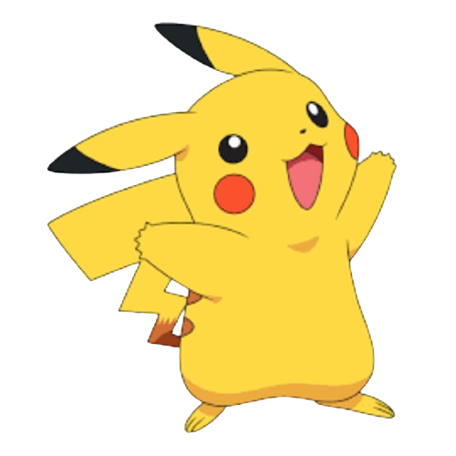
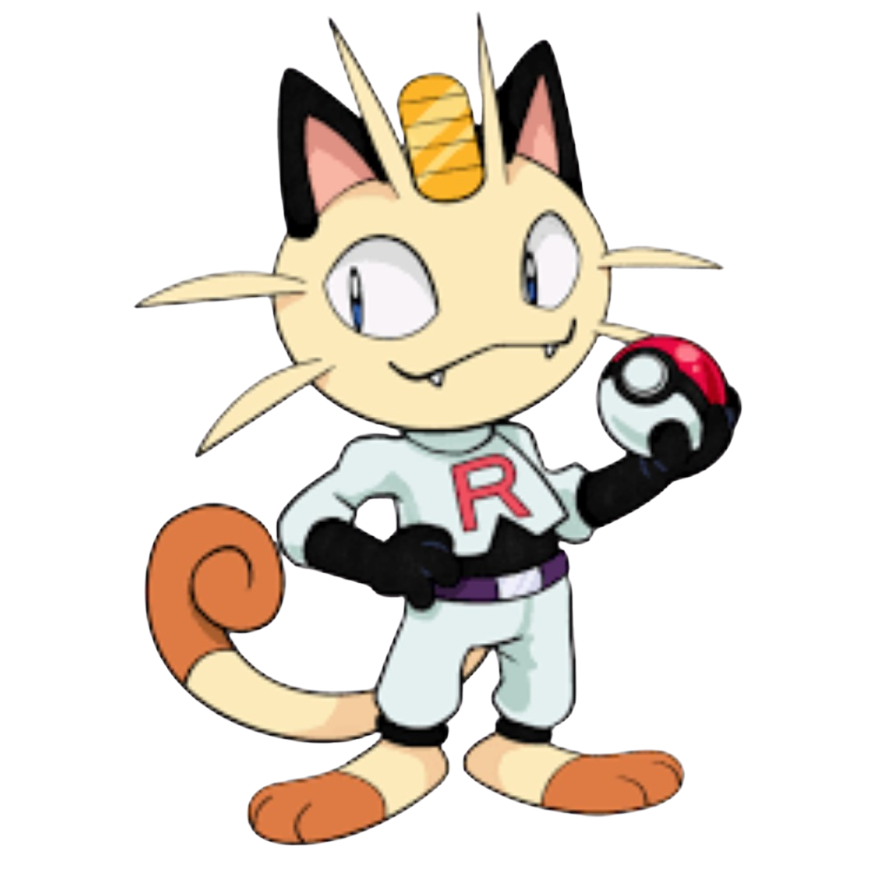
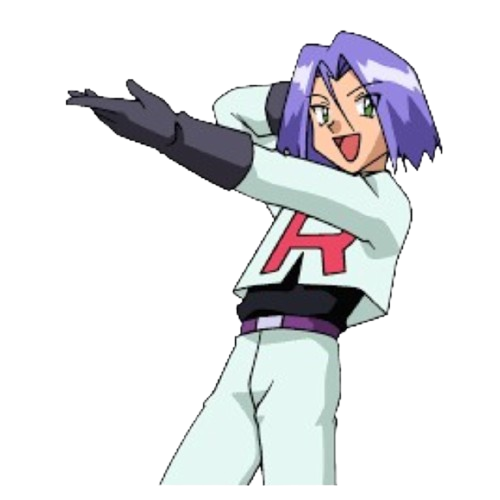
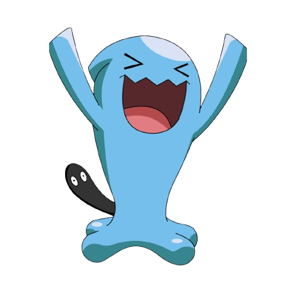
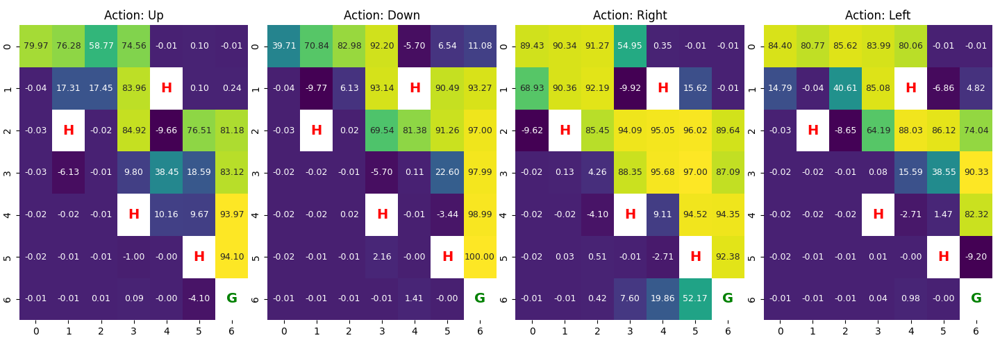

# ⚡ Pikachu Escape

> *Can a tiny electric mouse learn to dodge Team Rocket and make it back to Ash, with zero instructions and a lot of trial and error?*

**Pikachu Escape** is a custom reinforcement learning environment built with Python and OpenAI's [Gymnasium](https://gymnasium.farama.org/), where a **Q-learning agent** learns from scratch to navigate a grid world, avoid Team Rocket's traps, and reach its trainer. Training is rendered live with Pygame, and the learned Q-values are visualized as heatmaps with Seaborn.

Built as a project for **Principles of Autonomy and Decision Making**.

---

## 🎬 The Cast

| | Role | Description |
|---|---|---|
|  | **The Agent** 🕵🏽 | Trusty pal Pikachu, the Electric-type mascot of the Pokémon franchise. |
|     | **Hell States** 😈 | Team Rocket (Jessie, James, Wobbuffet and the talking Meowth). Step on one and the episode ends. |
|  | **Goal State** ⚽️ | Ash, a young man on his way to becoming a Pokémon Master. Reach him and win. |

---

## 🧠 How It Works

### The environment
A 7×7 grid world implemented as a proper `gym.Env`, with everything you'd expect from a Gymnasium environment: `reset()`, `step()`, `render()`, `close()`, plus an action space, observation space, rewards, and an `info` dict (which tracks distance to the goal).

- **Actions** (`Discrete(4)`): Up, Down, Right, Left
- **Observation**: Pikachu's `(row, col)` position on the grid
- **Start**: top-left corner `(0, 0)`
- **Rewards**:

| Event | Reward |
|---|---|
| Reach the goal (Ash) | **+100** |
| Step on a hell state (Team Rocket) | **−10** |
| Every other step | **−0.01** (nudges Pikachu to find shorter paths) |

An episode ends when Pikachu reaches Ash or gets caught by Team Rocket.

### The agent
Tabular **Q-learning** with an ε-greedy policy:

1. Initialize a Q-table of zeros (`grid × grid × actions`)
2. For each episode, start Pikachu at `(0, 0)`
3. Pick an action: explore randomly with probability ε, otherwise exploit the best known action
4. Update the Q-value with the Bellman equation:

   ```python
   Q[s, a] = Q[s, a] + alpha * (reward + gamma * max(Q[s']) - Q[s, a])
   ```
5. Decay ε after every episode so Pikachu explores less as it learns
6. Save the final Q-table to `q_table.npy`

### Default hyperparameters

| Parameter | Value | Meaning |
|---|---|---|
| `learning_rate` (α) | 0.1 | How quickly new info overrides old |
| `gamma` (γ) | 0.99 | Discount factor |
| `epsilon` | 1.0 | Initial exploration rate |
| `epsilon_min` | 0.1 | Minimum exploration rate |
| `epsilon_decay` | 0.995 | Per-episode decay of ε |
| `no_episodes` | 1000 | Training episodes |
| `goal_coordinates` | `(6, 6)` | Where Ash is waiting |
| `hell_state_coordinates` | `[(2, 1), (0, 6), (6, 0), (5, 5)]` | Team Rocket's positions |

---

## 📊 Visualizing What Pikachu Learned

After training, Seaborn heatmaps show the Q-value for each action (Up / Down / Right / Left) in every cell. Hell states are marked **H** and the goal is marked **G**. Brighter cells mean higher expected reward, so you can literally watch the "path of least Rocket" light up toward the goal.



---

## 🗂️ Project Structure

```
Pikachu-Escape/
├── main.py              # Entry point: configure, train, and visualize
├── q_learning.py        # Q-learning training loop + heatmap visualization
├── pikachu_escape.py    # Custom Gymnasium environment (Pygame rendering)
├── q_table.npy          # Learned Q-values (generated after training)
├── background.png       # Grid tile art
├── player.png           # Pikachu
├── goal.png             # Ash
├── hell1.png ... hell4.png  # Team Rocket
└── Figure_1.png         # Example Q-table heatmap
```

---

## 🚀 Getting Started

### Prerequisites
- Python 3.8+

### Install

```bash
git clone https://github.com/<your-username>/Pikachu-Escape.git
cd Pikachu-Escape
pip install gymnasium numpy pygame seaborn matplotlib
```

### Run

```bash
python main.py
```

A Pygame window opens so you can watch Pikachu stumble around early on and get smarter as ε decays. When training finishes, the Q-table is saved and the heatmaps pop up.

In `main.py` you can flip two switches:

```python
train = True              # set False to skip training and reuse a saved q_table.npy
visualize_results = True  # set False to skip the heatmaps
```

Want a different map? Change `goal_coordinates` and `hell_state_coordinates` in `main.py`.

---

## 🛠️ How the Project Evolved

- **V1:** A basic playing field with manual controls (↑ ↓ ← →)
- **V2:** Random actions using Python's `random` library
- **V3:** Q-learning, for a much more tangible, goal-directed approach

---

## 🧗 Challenges & Lessons Learned

- **Rendering vs. training speed:** Pausing with `time.sleep()` (e.g. to flash a "caught!" image) was far too slow when training over many episodes, so `clock.tick(10)` is used to slow the agent down just enough to watch.
- **Goal pop-up:** A "goal reached" pop-up image wasn't practical, since the agent reaches the goal many times during training.
- **Big takeaway:** Building a full Gymnasium environment from scratch (spaces, rewards, termination) and seeing how reward design and ε-decay shape the learned policy.

---

## 🔮 Ideas for Next Steps

- Add a "play" mode that runs the trained greedy policy without exploration
- Plot reward-per-episode learning curves
- Randomize hell state positions between episodes
- Try Deep Q-Networks (DQN) on a bigger grid

---

## 🙌 Acknowledgements

Pikachu, Ash, and Team Rocket are characters from the Pokémon franchise, © Nintendo / Game Freak / The Pokémon Company. This is a fan-made educational project and is not affiliated with or endorsed by them.

---

⭐ If you had fun watching Pikachu escape, consider giving the repo a star!
